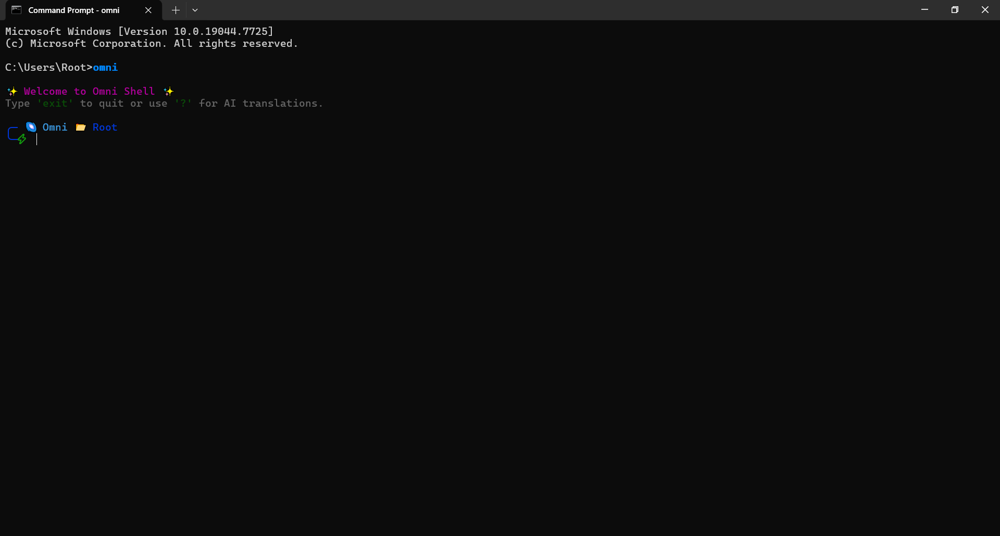

# Omni Shell ✨


Have you ever forgotten that one obscure Git command, or struggled to remember the exact flags for `tar`? Meet **Omni Shell** – a smart, AI-powered terminal environment that lets you type in plain English and translates it directly into executable shell commands!

Omni Shell is a custom Python-based terminal built using `prompt_toolkit`, `rich`, and AI integration. It seamlessly blends native terminal capabilities with a natural language interface. 

## 📸 Screenshot


## ✨ Key Features
- 🤖 **Natural Language to Shell:** Just type `? how do I find all python files modified today?` and watch Omni generate the right command!
- 🎨 **Beautiful UI:** A dynamic, multiline ZSH-style prompt with Git branch tracking, Python VENV detection, and execution time metrics.
- ⚡ **Built-in Power Tools:** Native `search` for web queries and `read` for file inspection without leaving the terminal.
- 🔋 **AI Tracking:** Real-time tracking to monitor your LLM usage.

## 🚀 Installation

1. Clone the repository:
```bash
git clone https://github.com/yourusername/omni-shell.git
cd omni-shell
```

2. Install the package locally:
```bash
pip install -e .
```

3. Setup your environment variables:
```bash
cp .env.example .env
```
*Make sure to add your Gemini API key in the `.env` file.*

4. Run the shell:
```bash
omni
```

## 🤝 Contributing
Please see [CONTRIBUTING.md](CONTRIBUTING.md) for details on how to contribute to this project.

## 📄 License
This project is licensed under the MIT License - see the [LICENSE](LICENSE) file for details.
